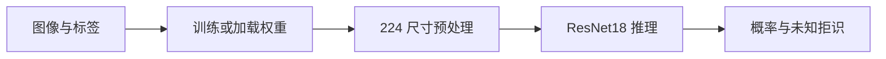

# 图像分类、推理服务与实验复现 · 工程导读

围绕八类动物图像，连接模型训练、数据处理与 Web / 桌面推理展示，重点体现从模型到应用的完整路径。

## 先理解核心流程



## 值得深入的设计

- 推理接口转换 RGB、调整图像尺寸并归一化，输出 Top-5 类别概率和本次推理耗时。
- 最高概率低于 0.60 时标记未知；该阈值是当前规则，不等同于经过校准的开放集识别能力。
- 训练、配置和 Web 服务应共享相同的标签顺序与权重结构，否则预测标签可能与模型输出错位。

## 沿源码验证能力

1. **[推理接口](../src/app.py)**：沿此入口检查实际实现与调用关系。
2. **[训练脚本](../src/train_model.py)**：沿此入口检查实际实现与调用关系。
3. **[统一配置](../src/config.py)**：沿此入口检查实际实现与调用关系。
4. **[数据管理](../src/data_manager.py)**：沿此入口检查实际实现与调用关系。
5. **[桌面界面](../src/gui.py)**：沿此入口检查实际实现与调用关系。
6. **[质量工具测试](../tests/test_data_manager.py)**：沿此入口检查实际实现与调用关系。

## 最短运行路线

以下为仓库既有脚本或配置对应的命令。命令以类 Unix Shell 为例，在仓库根目录执行；先准备所需服务和配置，不代表本次文档修改已经完成运行验证。

```bash
python -m pip install -r requirements.txt
# 准备匹配的模型权重：models/最终动物识别模型_10k.pth
python src/app.py
```

## 一次演示应验证什么

1. 权重不在仓库中；缺失权重时预测接口返回模型未加载，不能仅凭网页可打开判断推理可用。
2. 核对训练输出、Web MODEL_PATH 和类别顺序，使用已知类别图片完成一次预测。
3. 保存同一数据划分、权重版本、评测脚本和设备信息，再报告准确率及耗时。

## 当前边界与复现条件

- README 的 92.29%、Web 指标常量和 config.py 默认值并非同一可追溯评测结果，本次没有重新训练或评测。
- 现有性能数字未附完整硬件与输入条件，不能作为跨环境时延承诺。
- 数据集和模型文件需另行准备；应遵守原始图片来源的使用条件。

## 继续贡献

建议从最小可复现场景开始：描述输入、预期输出、实际结果、运行版本和相关日志，再提交 Issue 或针对对应模块的 PR。测试与性能结果需注明实际执行环境；不要仅根据功能列表推断生产可用性。

[返回项目首页](../README.md)
